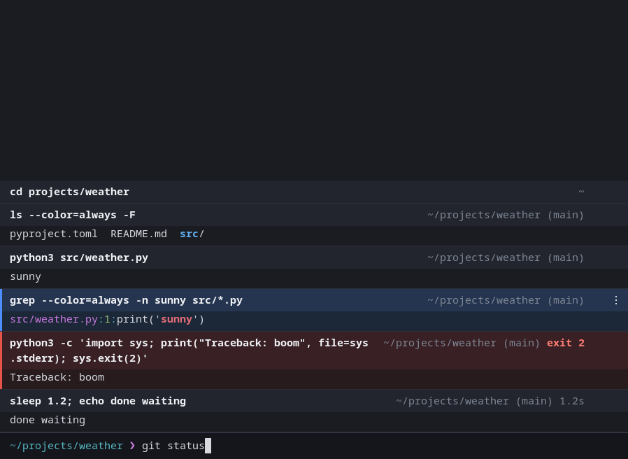

[](https://claude.com/claude-code)
[](https://codecov.io/gh/AsgerJon/jupyterminal)
[](https://pypi.org/project/jupyterminal/)
[](https://opensource.org/licenses/Apache-2.0)

# jupyterminal v0.0.0

A terminal emulator whose session is a list of **blocks** instead of one
continuous scroll. A block is one command plus everything it printed, kept
as a unit you can select, copy and jump to. Copying a command's output
takes one click and one shortcut — never a careful mouse drag.



Built from `Block Terminal Cleanroom Functional Spec.pdf` alone. Linux,
zsh, keyboard and mouse.

## Install and run

```sh
conda env update -n jupyterminal_env -f environment.yml   # or: pip install -e .
jupyterminal                                              # or: python -m jupyterminal
```

Needs Python ≥ 3.12, PySide6 and zsh. Options: `--shell PROGRAM`,
`--login`, `-d DIR`, `--config FILE`, `--print-default-config`.

Python 3.11 is left out on purpose. PySide6 6.12.0 ends the interpreter
there ("deallocating None") after a few thousand calls into Qt
(PYSIDE-3474); from 3.12 on that kind of mistake in a binding can no
longer do harm.

## Using it

The window is a list of blocks with the shell's prompt pinned underneath.
Type as in any terminal: line editing, completion and history are zsh's
own. Pressing Enter creates a block; its output streams into it; when the
command ends the block records the exit code and duration. A failed
command gets a red bar and a tinted background.

| Do this | To get this |
| --- | --- |
| Click a block | Select it (Ctrl+click toggles, Shift+click takes a range) |
| `Ctrl+Shift+C` | Copy: the selected text if there is any, otherwise the output of the selected blocks |
| `Ctrl+Alt+Shift+C` | Copy `$ command` followed by the output |
| Drag, double-click, triple-click | Select text, a word, a line (also fills the primary selection) |
| `Ctrl+Shift+V`, `Shift+Ins`, middle click | Paste clipboard / primary selection |
| `Ctrl+Up` | Select the newest block |
| `Up` / `Down` | Move the selection (with Shift: extend it) |
| `Ctrl+Shift+Up` / `Down` | Scroll to the top / bottom of the selected block |
| `Esc`, or just type | Back to the prompt |
| Right-click, or the ⋮ button | Block menu: copy output / command / both, find, filter, collapse, re-run, save to file |
| `Ctrl+Shift+F` / `Ctrl+Shift+L` | Find in block / filter output |
| `Ctrl+L`, `clear` | Scroll blocks out of view (they stay reachable) |
| `Ctrl+Shift+K` | Remove all blocks |
| `Ctrl+=` `Ctrl+-` `Ctrl+0` | Font size |

A command scrolled off the top stays pinned while its output is visible
(click it to go to the block's start); a block taller than the window
shows a jump-to-end button. Hovering a header shows when it started.

### What copying gives you

Plain text, exactly what the program printed: no colours or escape codes;
a line the window wrapped is one line; trailing spaces and the final
newline are dropped, tabs and blank lines are kept; a progress bar that
redrew itself copies as its final state; several blocks are joined in
order with one blank line between; with a filter active, only the lines
shown.

### Programs

Inside a block the terminal is an ordinary xterm-compatible one: 24-bit
colour, cursor movement, in-place progress bars, size queries. A REPL or a
yes/no question lives in its block until it exits. Full-screen programs
(vim, htop, less) take over the whole view; afterwards the block keeps its
command, whatever was printed outside full-screen mode, and a
"full-screen" marker.

## Configuration

`~/.config/jupyterminal/config.toml`; `jupyterminal --print-default-config`
prints every key with its default. Font, shell, history cap
(`scrollback_lines`, default 2,000,000 — the oldest blocks are dropped
whole), colours, and every shortcut:

```toml
[keys]
copy = "Ctrl+Y"
[keys.blocks]            # while a block is selected
previous = "K"
next = "J"
```

A setting that cannot be used is reported on standard error when the
program starts: the file, the setting, what it holds and what it may
hold. The default stays in effect, and a misspelled colour is answered
with the name that was probably meant.

## How blocks are known

Nothing is guessed from what output looks like. The terminal starts zsh
with `ZDOTDIR` pointing at a private directory of shims that run your own
startup files unchanged and then load a small integration script
(`src/jupyterminal/shell/zsh/integration.zsh`). Its hooks emit private
escape sequences when a command starts (with its exact text and
directory) and ends (with its exit code), each carrying a per-session
nonce so printed text cannot fake one. `ZDOTDIR` is restored and nothing
of this stays in your environment. `exec zsh` (typed, aliased, or at the
end of a compound line) re-integrates; a nested or remote shell is simply
one long block.

If your system sets `ZDOTDIR` in `/etc/zsh/zshenv`, zsh never reads the
shims and the whole session shows up as one block. Add this line to your
own `.zshrc` to load the integration directly:

```zsh
[[ -n $JUPYTERMINAL_DIR ]] && source $JUPYTERMINAL_DIR/integration.zsh
```

Output that arrives while no command runs — shell startup messages, a
"job done" notice, a background job printing — goes into a
"background output" block rather than onto your prompt.

## Decisions made where the spec left room

- **Header**: command in bold on a tinted strip; directory and git branch,
  duration, exit code and controls right-aligned on the same line.
- **Not run**: a line the shell rejects (a parse error) becomes a block
  marked "not run" holding the shell's message, so the error is not lost.
- **Save to file** writes the copy text plus a final newline.
- **One endless block**: the cap drops whole blocks only, but a single
  block larger than the entire cap has nothing older to drop, so its own
  oldest lines go (the header says how many). Otherwise `yes` would eat
  all memory.
- **Background output at the prompt** goes to its own block only while
  the line editor is provably idle: about half a second after your last
  key, and with no other plugin registered that may redraw the line at
  any time. A "job done" notice from zsh always gets its block.
- **A pasted single line** loses its trailing newline, so pasting never
  runs anything by itself; several lines ask first.
- **`clear`** scrolls its own (empty) block out of view too.
- Typing while a block is selected clears the selection.

## Not there yet

- Background output that arrives while it cannot be told apart from the
  line editor's own drawing (you are typing, or an async prompt plugin is
  active) lands on the prompt as in any terminal, and is not kept in a
  block.
- A function that calls `exec zsh` is not recognised; after it the
  session is one block (type `exec zsh` itself, or use an alias).
- Mouse reporting reaches programs in full-screen mode and at the prompt,
  not ones drawing inside a block.
- No hyperlinks (OSC 8), images, or extended keyboard protocols.
- Other shells run, but without integration the session is one block.
- The interface is tested through Qt's off-screen platform; see below.

## Development

```
src/jupyterminal/term      terminal emulation: parser, screen model
src/jupyterminal/shell     the pty and the zsh integration
src/jupyterminal/session   blocks, the router that fills them, copy rules
src/jupyterminal/ui        the Qt interface
```

`pytest` runs everything and measures the branch coverage: the emulator,
the router, a real zsh under the session, the window driven off screen,
and `tests/test_acceptance.py`, which has one test per acceptance
criterion of the spec. `pytest -m "not live"` runs the tests that need no
shell, in a few seconds.

[CONTRIBUTING.md](CONTRIBUTING.md) has the rest: the 100% coverage rule,
mutation testing before a release, and the nine buttons that publish one.
